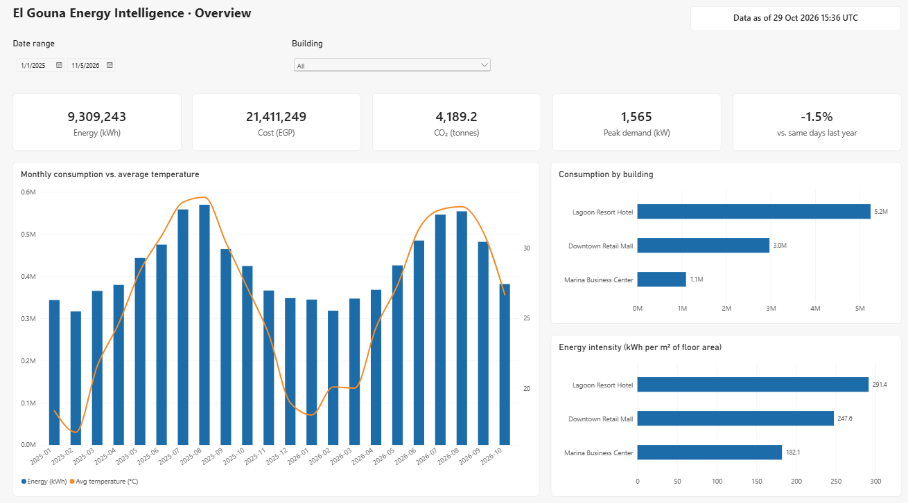
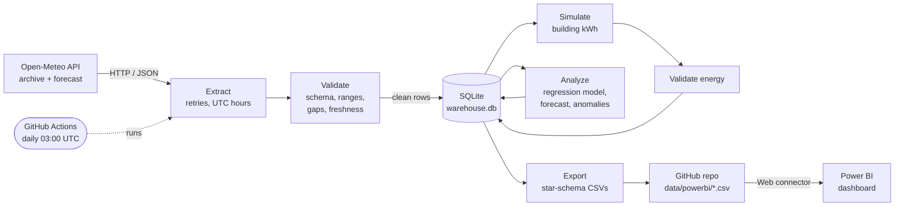
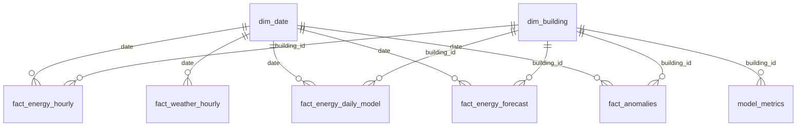

# Weather-Aware Energy Intelligence Dashboard

[](https://github.com/samerraef16-hash/weather-energy-dashboard/actions/workflows/pipeline.yml)

An automated data pipeline that pulls live weather for **El Gouna, Egypt** from
the [Open-Meteo API](https://open-meteo.com/), combines it with simulated
electricity consumption for three buildings, validates and stores the data,
models how heat drives energy use, and feeds an interactive **Power BI** dashboard.

New data arrives every day with **no manual collection**: GitHub Actions
runs the pipeline each morning and publishes fresh CSVs, and Power BI loads them
straight from this repository.

<!-- Add screenshots after building the report (see docs/powerbi_guide.md, step 7) -->
<!--  -->

---

## Architecture



| Stage | What happens | Code |
|---|---|---|
| **Extract** | First run backfills hourly history from the Open-Meteo *archive* API (from Jan 2025). Every run then pulls the last 7 days plus a 7-day *forecast*. Requests retry with exponential backoff. | [`extract.py`](energy_pipeline/extract.py) |
| **Validate** | 17 data-quality checks per run. Structural problems (missing columns, duplicate hours) **stop the run**; impossible values (e.g. 80 °C) are **quarantined** and logged. | [`validate.py`](energy_pipeline/validate.py) |
| **Store** | SQLite warehouse with idempotent upserts: re-running is safe, and an actual reading replaces the forecast made for that same hour. | [`store.py`](energy_pipeline/store.py) |
| **Simulate** | Hourly kWh for a resort hotel, an office (Egyptian Sun–Thu work week) and a retail mall, driven by temperature, sunshine and occupancy. The noise is deterministic, so history never changes between runs. | [`simulate.py`](energy_pipeline/simulate.py) |
| **Analyze** | Time-of-week-and-temperature regression with learned balance-point temperatures, evaluated on a 30-day hold-out. Predicts the next 7 days and flags anomalous hours with a robust z-score. | [`analyze.py`](energy_pipeline/analyze.py) |
| **Export** | Writes a star schema (2 dimensions, 5 facts, 3 operational tables) as CSV for Power BI. | [`export.py`](energy_pipeline/export.py) |
| **Automate** | GitHub Actions runs the tests, then the pipeline, then commits the refreshed data. A failed run is logged too, and shows up on the dashboard. | [`pipeline.yml`](.github/workflows/pipeline.yml) |

## Model results

Measured on the most recent 30 days, which the model never saw during training (values from the first run; they update daily in `model_metrics.csv`):

| Building | MAPE | R² | Extra kWh per hour for each +1 °C | Injected faults detected |
|---|---|---|---|---|
| Lagoon Resort Hotel | 3.4 % | 0.89 | 17.7 | 100 % |
| Marina Business Center | 3.3 % | 0.99 | 3.3 | 100 % |
| Downtown Retail Mall | 3.4 % | 0.99 | 9.8 | 100 % |

The simulator secretly injects rare equipment faults (+50–100 % load). Because
the data is simulated, the ground truth is known, so the anomaly detector's
recall can actually be measured, which you rarely can with real data.

## Power BI data model



Report pages: **Overview** · **Weather Impact** · **Forecast & Model** · **Pipeline Health**.
The full build guide, written for first-time Power BI users, is in
[`docs/powerbi_guide.md`](docs/powerbi_guide.md). The DAX measures are in
[`powerbi/measures.dax`](powerbi/measures.dax) and the Power Query scripts in
[`powerbi/power_query/`](powerbi/power_query/).

### How the dashboard stays up to date

1. Every day at 03:00 UTC, GitHub Actions runs the pipeline and commits new CSVs.
2. Power BI loads each table from its permanent raw GitHub URL, e.g.
   `https://raw.githubusercontent.com/samerraef16-hash/weather-energy-dashboard/main/data/powerbi/fact_energy_hourly.csv`.
3. Clicking **Refresh** in Power BI Desktop pulls the latest data.
   Published to the Power BI Service, the same report could refresh itself on a
   schedule with no gateway, because the source is a public web URL.

## Run it locally

```bash
git clone https://github.com/samerraef16-hash/weather-energy-dashboard.git
cd weather-energy-dashboard
python -m venv .venv
.venv\Scripts\activate          # Windows  (macOS/Linux: source .venv/bin/activate)
pip install -r requirements.txt

pytest                          # 20 tests, no internet needed
python -m energy_pipeline       # fetch, validate, store, analyze, export (~25 s)
```

To track a different city or building portfolio, edit [`config.toml`](config.toml).
No code changes are needed.

## Repository structure

```
├── .github/workflows/pipeline.yml   # daily automation
├── config.toml                      # location, buildings, tariff, API settings
├── energy_pipeline/                 # the Python package (one module per stage)
├── tests/                           # unit + end-to-end tests (API mocked)
├── data/
│   ├── warehouse.db                 # SQLite warehouse (updated daily)
│   └── powerbi/*.csv                # star-schema exports read by Power BI
├── powerbi/
│   ├── power_query/*.pq             # Power Query (M) script per table
│   ├── measures.dax                 # all DAX measures
│   └── WeatherEnergyDashboard.pbix  # the report
└── docs/powerbi_guide.md            # step-by-step build guide
```

## Design decisions

- **UTC internally, local time at the edge.** Egypt observes daylight saving
  time, so local clocks skip or repeat an hour twice a year. All processing
  uses UTC; local El Gouna time is added only in the export.
- **Append-only hourly facts.** Model outputs, which change on every retrain,
  live in small separate tables, so the daily git commits stay small instead of
  rewriting a 5 MB file.
- **CSV in Git as the serving layer.** It's free, versioned and reachable by
  URL. It suits this data volume (about 50k rows/year); a larger system would
  use a cloud database or object storage.
- **Simulated consumption, clearly labelled.** Real building meter data is
  rarely public. The simulator is physically motivated, and it allows the anomaly
  detector to be scored against known faults.

## Limitations & next steps

- Consumption is simulated. Swapping in real meter data only means replacing
  `simulate.py` with another extract step.
- Power BI Desktop refresh is one click. Fully hands-off refresh requires the
  Power BI Service (work/school account).
- GitHub disables scheduled workflows after 60 days without repository
  activity. Re-enable it from the Actions tab if that happens.
- Ideas: tariff time-of-use pricing, solar PV simulation, more cities, alerting
  (e-mail when an anomaly is detected).

## Data & attribution

Weather data by [Open-Meteo.com](https://open-meteo.com/), licensed under
[CC BY 4.0](https://creativecommons.org/licenses/by/4.0/). Building consumption,
tariff (EGP 2.30/kWh) and grid emission factor (0.45 kg CO₂/kWh) are
illustrative values for demonstration only.

## License

[MIT](LICENSE)
